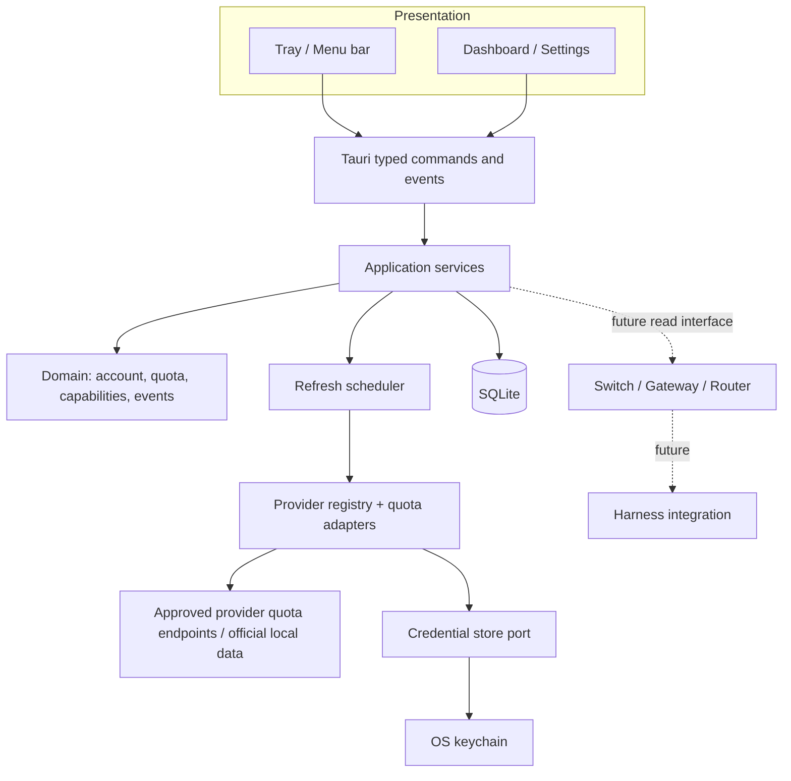
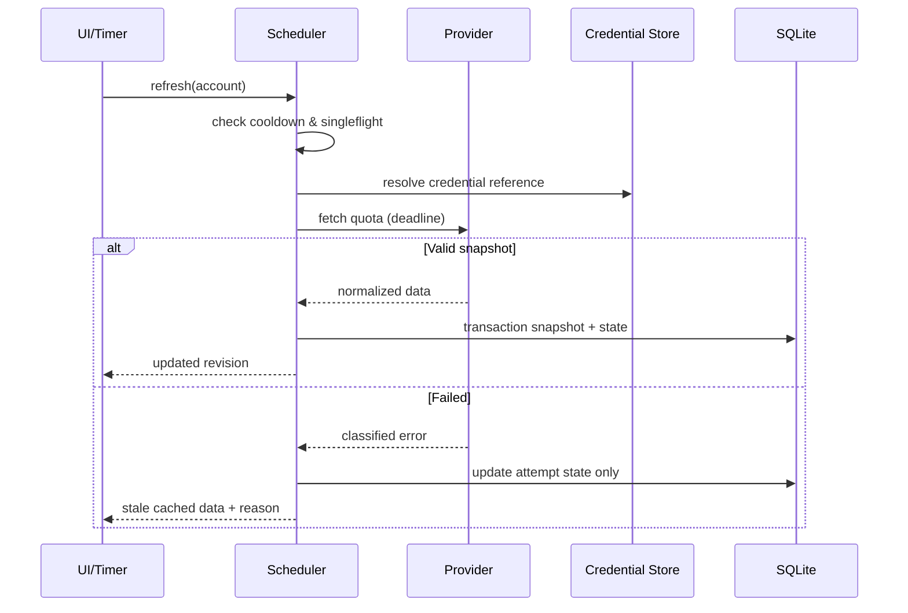

# 系统架构与接口契约

> 实现状态：M0 离线 Demo、托盘和面板已实现；M1 已新增 SQLite 仓储、密钥端口、账户应用服务、静态 Provider registry、同步刷新调度核心和进程内缓存/状态事件。完整认证、异步 Provider、持久化 refresh state 和真实刷新仍为后续设计；详见 [ADR-0002](adr/0002-m0-demo-contract.md)、[ADR-0003](adr/0003-m1-sqlite-storage.md)、[ADR-0004](adr/0004-m1-secret-store.md)、[ADR-0005](adr/0005-m1-account-service.md)、[ADR-0006](adr/0006-m1-refresh-scheduler.md) 与 [ADR-0007](adr/0007-m1-cache-state-events.md)。

## 技术选型
Rust stable + Cargo Workspace；Tauri 2 + React + TypeScript + Vite + pnpm；Tailwind + shadcn/ui（按需组件）+ Lucide；Zustand 用于 UI 状态，服务端状态采用简单查询缓存或 TanStack Query（M0 实测决定）；Tokio、Reqwest、Serde、rusqlite、keyring、tracing、thiserror、uuid、chrono 或 time（二选一）。版本在 M0 依据兼容性锁定，禁止追逐无理由升级。图表优先轻量 SVG/Recharts，未实现历史前不引入大图表库。



实线当前，虚线未来；依赖方向为 UI/基础设施指向稳定领域契约，Core 不依赖桌面或数据库。MVP 运行在单个桌面进程，后台 Tokio 任务；暂不创建常驻独立服务。

## 仓库布局（拟议，按里程碑创建）
```text
apps/desktop/             React + src-tauri
crates/prism-core/        领域模型、错误、端口
crates/prism-app/         用例、调度、快照管理
crates/prism-scheduler/   时钟、冷却、singleflight、退避
crates/prism-providers/   注册表、Demo、各厂商 module
crates/prism-storage/     SQLite 仓储、迁移
crates/prism-security/    OS credential store
packages/shared-types/    生成的 DTO/schema（M0 确定生成方案）
fixtures/providers/       脱敏 fixture
scripts/                  开发辅助
```
不提前创建每个厂商的独立 crate，达到规模后再拆分；CLI、网关、路由、配置适配和 Harness 均待相应版本新增。

## 领域实体与不变量
- ProviderId：稳定字符串；AccountId：UUID；Account：provider_id、alias、enabled、credential_ref、plan_label、created_at。凭据引用是不可直接使用的标识，不是凭据。
- Capability：`quota_read`、`balance_read`、`usage_history_read`、`inference`（未来，默认 denied）、`config_switch`（未来）。每项记录 support/evidence/auth method、允许的协议及限制。读取权限与推理权限独立。
- QuotaSnapshot：account_id、observed_at、source_kind、freshness、windows[]、balances[]、warnings[]、schema_version。source_kind = official_api / official_cli / authorized_experimental / estimated / demo。失败信息单独存储，不能覆盖最后一次成功快照。
- QuotaWindow：window_id（稳定）、pool_id（可选共享池）、label、scope（account/model/tool）、unit、period、used/limit/remaining、reported_remaining_percent、reset_at、next_recovery_at、observed_at、precision；值均可空。时间 UTC。Period = rolling(seconds) / fixed / billing / lifetime / unknown。Unit = token / request / credit / percent / currency(ISO code) / custom。共享 pool 不重复累计。
- Balance：decimal amount、currency、scope、observed_at、source。货币和 Credits 独立；整数计数用 u64 或明确 decimal，避免 f64 精度损失；比例可用有界浮点或定点值，检查 0..100。
- RefreshState：last_attempt_at、last_success_at、reason、retry_after、in_flight。ErrorKind：auth / permission / rate_limit / network / timeout / schema / unsupported / storage / cancelled / unknown。
- Future: ModelDeployment、InferenceCapability、ClientProfile、RoutePolicy、UsageEvent、Reservation（见 EVOLUTION）。仅文档预留，不实现。

## 适配器接口（示意，待 M0 编译）
```rust
#[async_trait::async_trait]
pub trait QuotaProvider: Send + Sync {
    fn metadata(&self) -> ProviderMetadata;
    fn capabilities(&self) -> ProviderCapabilities;
    async fn validate(&self, account: &AccountContext) -> Result<(), ProviderError>;
    async fn fetch_quota(&self, account: &AccountContext) -> Result<QuotaSnapshot, ProviderError>;
}
```
AccountContext 提供短生命周期 secret accessor、受限 HTTP client、取消信号、时钟；不把原始凭据传到 UI。Provider registry 静态注册；网络策略、刷新策略和序列化错误由公共组件承担。未来 `InferenceProvider` 独立于 `QuotaProvider`，禁止通过扩展一个巨型 trait 耦合。

## 数据库存储
SQLite 单库，开启 foreign_keys，WAL 在目标平台验证；单写入队列/阻塞线程，禁止阻塞 Tokio runtime。迁移事务化，备份不含 keychain secret。

| 表 | 关键字段 / 约束 |
|---|---|
| accounts | id PK, provider_id, alias, credential_ref, enabled, plan_label, created_at |
| quota_snapshots | id PK, account_id FK, observed_at, source, schema_version, normalized_json；索引(account_id, observed_at DESC) |
| refresh_state | account_id PK/FK, last_attempt, last_success, error_kind, retry_after |
| settings | key PK, typed JSON value, updated_at |
| notification_state | account_id, window_id, cycle_fingerprint, threshold, last_sent; 唯一组合 |
| subscriptions（P1） | id, account_id, price_decimal, currency, renewal_at, billing_interval |

最近快照与历史可共用表；v0.1 仅保留最近成功数据（或受限历史），v0.2 默认 90 天并可清除。Demo 使用内存隔离。账户删除事务处理快照和通知；凭据删除跨系统库不能原子化，使用可恢复操作记录与重试，避免丢失引用。禁止存原始 HTTP 响应。

## IPC 设计
所有命令返回 `Result<T, PublicError>`（稳定 code、message_key、retry_after、可选脱敏 detail）。建议：
| Command | 入参 | 出参 |
|---|---|---|
| list_providers | none | ProviderSummary[] |
| list_accounts | none | AccountSummary[] |
| add_account | provider_id, alias, auth_input | AccountSummary（无 secret） |
| update_account | account_id, patch | AccountSummary |
| remove_account | account_id | operation result |
| validate_account | account_id | ValidationResult |
| get_overview | none | OverviewDto |
| refresh_accounts | account_ids? | RefreshAccepted（operation ID） |
| get_settings / update_settings | none / patch | Settings |
| enter_demo / exit_demo | none | DemoState |

事件 `quota://updated`（account_id, revision）、`refresh://state`、`accounts://changed`；事件只做 UI 失效通知，UI 查询最新 DTO。首次订阅后获取最新 revision，处理乱序。IPC 权限限制到本地窗口，不开放任意 shell、文件路径、网络 URL 或凭据读取。UI 无法调用未来网关。

## 刷新时序

调度采用 semaphore + per-account singleflight，睡眠恢复触发受限刷新；401 暂停直到认证更新，429 尊重 Retry-After，5xx/网络指数退避，schema 错误标记不兼容。取消信号贯穿请求。通知只由持久化后的可靠快照驱动。日志 trace_id 不含账号名或 key。

## 可演进性
提供稳定只读 `QuotaReader` / `AccountCatalog`，将来源与授权能力纳入领域；未来路由复用它们，而不是读取 UI 或 SQL 私有表。未来 daemon 是否拆分、进程 IPC、插件 ABI 在阶段门重新评估。详见 EVOLUTION。
