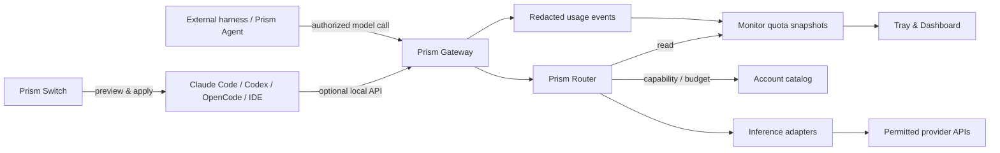
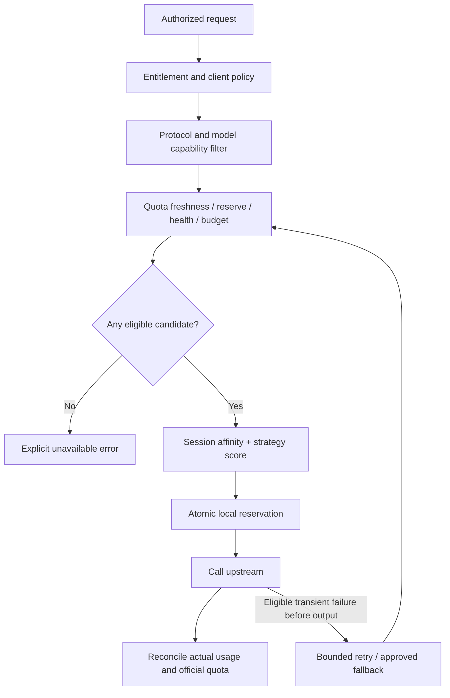
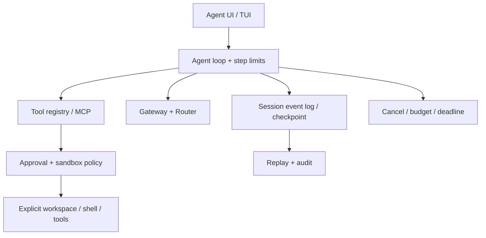

# 长期演进：从 Monitor 到个人 AI 控制中枢

**状态：规划，不是 MVP 开发任务。** 只有前一阶段满足验收且有真实用户需求时才启动下一阶段。未来每个模块都独立 feature gate、独立权限、独立失败隔离。可在不运行 Gateway/Agent 的情况下继续使用 Monitor。



## 1. Prism Switch：安全配置管理（目标 v0.3）
学习 CC Switch 的按客户端隔离配置、Direct/Routing 模式。MVP 完成之后才写外部配置。
- 账户和客户端 Profile 分开；同一供应商可能有不同区域、endpoint、认证及模型能力。
- `ClientAdapter`：discover（显式选择路径）、inspect、plan_patch、validate、apply、rollback。先支持 Claude Code / Codex / OpenCode，各自版本和操作系统建立兼容矩阵；Gemini CLI 后续。
- 直接模式只修改用户确认的 provider 相关字段；保留未知字段、注释（TOML）、MCP、hook、权限与原有环境变量。支持预览 diff（secret mask），原子写临时文件+rename，权限继承，旧文件加密/限制权限的备份，hash/CAS 防并发覆盖，失败回滚；检测 symlink/path traversal。涉及多文件用操作日志和恢复机制，不宣称跨文件原子性。
- 不自动导入第三方账号，也不删除官方登录文件。若必须写直接模式的上游 Key，明确提醒目标文件可能明文保存并由用户确认。优先使用客户端正式支持的引用机制；未来网关模式只写本地 Key。
- 只有支持的客户端可在后续请求即时切换；需要重启的明确提示，避免中断正在执行的任务。验收：保留用户配置、重复切换幂等、冲突检测、模拟写失败、恢复原样、Windows/macOS fixture。

## 2. Prism Gateway：本机统一 API（目标 v0.4）
可以实现“其他软件只填本机地址和 Key”。但前提是上游明确允许所选认证、协议、第三方客户端与请求方式。监控可见不等于可调用；个人订阅不等于通用 API 额度。为每个供应商/套餐建立 entitlement matrix，标明允许/拒绝/未知，未知默认拒绝。不做未经授权的 OAuth 转发、私有接口逆向代理、账号池共享、对外出售、绕过配额或自动用付费账户兜底。

### 客户端形态（示意，不是现有接口）
```toml
base_url = "http://127.0.0.1:17860/v1"
model = "prism-code-balanced"
api_key = "qp_local_EXAMPLE_NOT_A_REAL_KEY"
```
独立 client key 使用 CSPRNG 生成，每客户端一份，可撤销、轮换、设允许模型/额度预算。本地 Key 和上游 Key 绝不相同。服务默认关闭，只监听 loopback（IPv4，IPv6 独立测试），不提供 LAN/public 选项。所有入口认证，包括 models 与健康详情；安全最小化 health 可仅返回 alive。鉴权采用恒定时间比较的安全摘要；Secret 原文仅创建时展示，日志不含。限制 Host、Origin、请求体、并发、速率和空闲连接；不启用宽松 CORS，不支持任意代理目标。退出、崩溃、端口冲突都有明确状态。

### 协议阶段
| 阶段 | 能力 | 说明 |
|---|---|---|
| G1 | GET /v1/models、POST /v1/chat/completions | 优先支持真正授权的 OpenAI-compatible API；普通与 SSE |
| G2 | POST /v1/responses | Codex 等依赖 Responses 的客户端；需独立协议测试，不用简单字段替换 |
| G3 | POST /v1/messages | Anthropic Messages、工具调用及流式事件；能力协商与明确不支持 |
| G4 | 其他原生协议 | 按需求与授权扩展，不声称全协议兼容 |

Rust axum + Tokio + reqwest + SSE（具体版本届时确定）；协议适配与 Provider Inference adapter 分离。保留流式 backpressure、取消、超时、工具调用 ID、结束原因和 usage，处理多模态、reasoning、system role、JSON schema 等不兼容情况；不能无损转换时明确 400/unsupported，禁止静默丢弃。模型发现只返回当前 client key 能使用的真实模型/alias。

### 使用记录与部署
默认不保留 prompt、completion、tool args、原始响应；记录 request_id、匿名 client_id、model、account_id、状态、时延、实际 usage（可空）、来源、路由原因和可选货币成本。网关自身用量是观测的一部分，无法覆盖其他客户端直接产生的消耗，不能替代官方 quota。重启恢复、端口可配置；MVP 不提前拆 daemon，只有用户需要关闭 UI 仍提供服务或 CLI/进程隔离时再设计受认证本地 IPC（Unix socket / named pipe ACL）与进程生命周期。

## 3. Prism Router：额度感知调度（目标 v0.5）
### 领域契约
`ModelDeployment` = provider + account + model + protocol + capabilities + entitlement + limits；`RoutePolicy` = allowed groups、budget、fallback order、min quota reserve、freshness threshold、session affinity；`RequestRequirements` = model alias、context estimate、output max、tool/vision/structured output、privacy tags；`RouteDecision` = target、rule/version、exclusions、reason_codes、reservation ID。

### 决策流水线

硬约束优先：授权、模型上下文、工具支持、隐私标签、client allowlist、预算、有效额度、熔断。不同模型/协议默认不互换；用户显式创建兼容组与 fallback 列表。未知/过期数据默认不参与自动路由，用户可选手动目标并明确提示；额度共享池按 pool_id 原子预留，防同机并发超分配（不能保证外部客户端不消耗）。

### 初期策略
- `manual` / `priority`：显式目标或有序候选，最易解释。
- `quota_guarded`：先按该账户最紧限制窗口与预留量过滤，再在同一兼容组按健康、用户优先级、窗口压力、延迟等归一化指标排序；不同计量单位不直接相减。归一化剩余比例只表示各自限制压力，不能代表等价 token。缺失或共享额度需要特殊规则。
- `balanced`：在已验证的候选集合内可配置权重，提供每个分项及 reason code；模型质量是用户指定等级，不编造基准。
- `cost_aware`：只在明确的币种、价格、实际/估计使用量与预算下工作；未知成本保守处理。订阅已支付不代表每次请求成本为零。默认禁止自动转到按量计费服务，必须用户逐项启用并设硬预算。

示例：A（同组、已授权、5h 剩 12%、预留 15%）排除；B（同组、剩 68%、健康）优先；C（剩 90%、不支持工具调用）排除；D（付费、未允许）排除。这里没有跨单位额度汇总，也不会为了“用完套餐”制造额外请求。

### 并发与故障边界
- 预留是本机预测，不是供应商真实扣减。按请求估算 token 或该平台明确的请求计数，无法估计则限并发；reservation 到期/取消释放，实际 usage reconcile，官方快照为权威。跨窗口重置按实际 provider 规则处理。
- 429 进入带 Retry-After 的 cooldown；401/403 停用并提示重新授权；5xx/网络问题有限重试；无效请求、内容限制等不通过改厂商绕过。最大尝试次数、总 deadline 与候选去重。
- 已返回 SSE 内容后禁止透明重放、跨模型续接或重复工具调用；中断交给调用方。无输出也需考虑上游可能已执行/计费，明确未知结果，限制重试；支持幂等键时使用。会话黏性优先，避免破坏 prompt cache、tool state 和上下文。
- 测试 route decision fixture、并发 reservation、熔断恢复、超时、无候选、SSE 半途断开、预算竞态；支持离线 Dry-run UI，解释候选排除原因。

## 4. Prism Agent：Harness 集成先行（v0.6+ / 探索）
DeepSeek Harness 把模型适配、工具注册、会话事件、Agent loop 设计为可扩展模块；DASH 是其 TUI 插件。优先通过合法的官方 SDK/插件/兼容 API 集成现有 Harness，让 QuotaPrism 提供只读 quota status、模型目录和经过认证的本地推理入口，而不是重新开发整个 Coding Agent。

### 两条路线
A. 集成：适配 DeepSeek Harness / 其他支持自定义 model endpoint 的工具；只读 MCP 提供 `quota_status`、`list_eligible_models`、`explain_route`，不返回 secret；需要写操作另行授权。CLI/TUI/IDE 仍由其原生客户端负责。
B. 自研：只有现有框架无法满足明确需求时启动。Rust 独立 `prism-agent` 或独立进程，评估 TS SDK 桥接（不要为了全 Rust 放弃成熟 SDK），保留事件契约与模型调用接口。先单 Agent，再 subagent、工作流；不绑定某个特定供应商。

### 可选执行架构

会话事件版本化：session_started、user_message、assistant_attempt、assistant_message、tool_requested、approval_granted/denied、tool_result、checkpoint、budget_exhausted、cancelled、session_finished。流式 chunk 是 UI 临时事件，提交后的日志用于恢复；不重复执行已完成的有副作用工具。工具使用 typed schema、权限分级、明确工作目录、禁止默认访问外部秘密；shell/网络/写文件按策略审批；不信任网页、文件或模型输出的指令。Agent 不因可读 quota 自动获得访问凭据或执行权限。

Agent 每步预算（请求次数、token/费用、wall clock、工具次数）以及父子共享预算；选择模型须能力匹配，明确切换理由，优先会话黏性；子任务可按用户策略用不同模型。失败时保存检查点、可取消、可审计，用户可以恢复或结束。安全风险包含 prompt injection、路径穿越、命令执行、数据外传；不默认执行高风险动作，不提供无限自主后台执行。正式实现前单独做威胁模型、数据保留、事件协议 ADR 和原型验收。

## 5. 决策门与退出条件
| Gate | 条件 | 不满足时 |
|---|---|---|
| Monitor → Switch | 数据模型稳定，真实适配与跨平台发布可靠；有配置切换诉求 | 继续优化 Monitor |
| Switch → Gateway | 合规 API 权限可证实、客户端兼容测试、配置恢复成功 | 保留 direct mode |
| Gateway → Router | 协议与 streaming 测试、用量来源和预算可验证 | 手动选择，禁自动调度 |
| Router → Agent | 调度可解释、预算守恒、集成方案评估、沙箱与审批 | 仅提供 Gateway/只读 MCP |

每阶段通过 ADR 验证复用价值；不承诺版本日期或特定上游永久可用。
