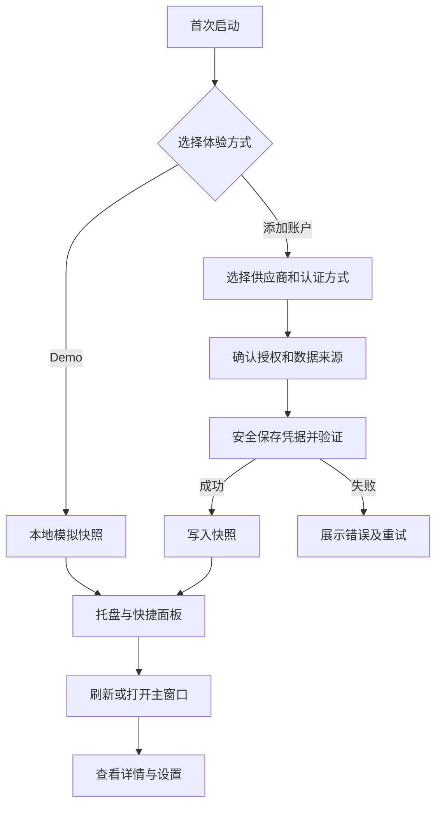

# MVP 产品需求与验收

## 版本边界
v0.1 目标 Windows/macOS；Demo + 至少三个经验证的真实 Provider 才可发布为 monitor preview；优先 Kimi、MiniMax、GLM，若不具备合法可用接口则换 DeepSeek 等可验证候选。Codex/Claude 作为首批候选而非强制承诺。候选未验证必须明确标记。v0.2 再完成历史分析、多账户管理完善、订阅与 CLI。

## 用户流程

## P0 功能
| ID | 需求 | 验收标准 |
|---|---|---|
| F01 | 首次启动与 Demo | 不配置 Key 即可交互；模拟标签醒目；Demo 不写入真实历史，不发网络请求 |
| F02 | 托盘 | 单实例；点击弹出/收起；主窗口关闭不退出；菜单含刷新、打开、退出；Windows/macOS 分别验收 |
| F03 | 账户 | 添加、编辑别名、启停、删除；同 Provider 多账号 ID 不冲突；认证测试仅调用额度接口 |
| F04 | 凭据 | 系统库读写删除；UI 不回显完整 Key；失败不得降级明文存储；删除时说明共享引用影响 |
| F05 | 额度卡片 | 显示多个窗口，单位、来源、更新时间；可选已用/剩余；没有分母不绘制百分比 |
| F06 | 刷新 | 启动/手动/周期；全局并发上限；同账号 singleflight；失败显示上次成功值与状态；退出取消 |
| F07 | 重置 | 绝对时间/剩余时间按真实来源显示；未知显示未知；滚动窗口只显示提供的下一恢复时刻 |
| F08 | 通知 | 可配置阈值、去重、静默；首次低额度提示；重置后恢复触发资格；过期数据不发误导通知 |
| F09 | 设置 | 语言、主题、刷新周期、固定排序、托盘重点账户、开机启动（明确授权） |
| F10 | 诊断 | 显示错误类型、最后成功时间、来源类型；复制脱敏诊断；无凭据或原始请求体 |
| F11 | 本地持久化 | 配置、账户元数据、最近快照与迁移；重启可离线看到缓存；支持删除账户和相关历史 |
| F12 | 主窗口 | 账户总览、详情、设置、帮助；空态/加载/错误/过期/离线均有独立视图 |

## P1（v0.2+）
历史曲线（同一账户/单位/窗口）、数据保留配置、手动登记套餐价格与续费日、利用率按完整周期计算、CSV/JSON 脱敏导出、线性预测、只读 CLI。历史短缺时显示不足，不给伪精确预测。

## 状态语义
`unconfigured`、`loading`（保留缓存）、`fresh`、`stale`、`offline`、`auth_required`、`rate_limited`、`unsupported`、`error`。数据新鲜度与错误原因分开；可同时 stale + auth_required。0% 仅当供应商确实报告耗尽；unknown 单独显示。状态切换不丢旧值。

## 默认建议参数（可调整）
全局 4 并发，每账号 1；刷新 300 秒、HTTP 超时 15 秒；缓存过期阈值 max(2 × interval, provider minimum TTL)，可由厂商策略覆盖；退避带 jitter，尊重 Retry-After；用户主动刷新也受限制。低额度默认 15%，恢复到 20% 或进入新窗口后重新武装通知。

## MVP 验收矩阵
- 正常：真实账号首次读取、重启缓存、各窗口切换、倒计时、手动刷新、注销。
- 异常：401/403/429/500、超时、格式变化、空响应、系统休眠、断网重连、凭据库锁定、SQLite 写失败、系统时间变化。
- UI：不同 DPI、屏幕边缘、任务栏各方位、多显示器、键盘和屏幕阅读器、深浅色、中英文长文本、窗口失焦。
- 安全：全项目 secrets 扫描；IPC 白名单；不请求生成接口；Demo 无网络；日志脱敏；账户删除与失败恢复。
- 发行：Windows 安装包、macOS 对应架构安装包经过实际安装/卸载测试；签名/公证未具备不得称为正式签名发布。
